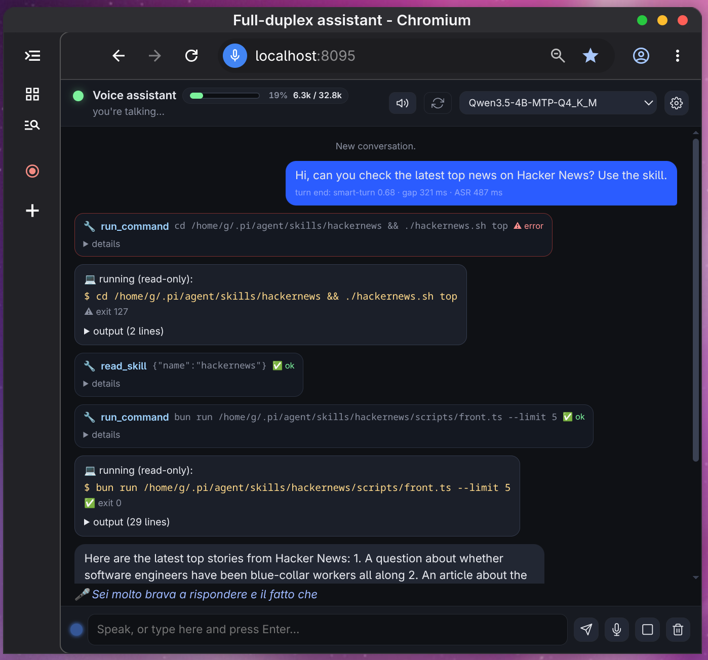

# Sonia Personal Assistant

**Sonia** is an LLM + STT + TTS voice assistant that needs **no dedicated GPU** and runs
in **less than 15 GB of RAM**, entirely on a local computer.
Multilingual and full-duplex: the mic stays open while the assistant talks — interrupt
it (barge-in) and it pauses, resumes or cancels accordingly. It mirrors whichever
language you speak (English/Italian tested).

<p align="center">
  
</p>

<p align="center">
  ▶️ <a href="https://www.youtube.com/watch?v=OWdT6Ow0MfM"><b>Sonia demo video</b></a>
</p>

Everything is local; the only external piece is an **OpenAI-compatible endpoint** (an
already-running `llama-server`, managed outside this project). Optionally and
experimentally, an existing `pi` executable can replace it — see [AI models used](#ai-models-used).

**Contents** — [Features](#main-features) · [Architecture](#architecture) ·
[Models](#ai-models-used) · [Installation](#installation) · [Security](#security) ·
[Inspiration](#inspiration) · [License](#license)

---

## Main features

- **True full-duplex listening** — the mic never closes; answers can be interrupted mid-sentence. Barge-in is echo-aware: backchannels and Sonia's own voice resume it, real speech cancels the reply and keeps what was already said.
- **Streaming ASR + layered turn detection** — partial transcripts drive the live `🎤 …` line; a turn ends on Silero VAD + silence gaps + the Smart Turn classifier, with a 4-token `LISTEN`/`REPLY` prompt only when the pause is ambiguous.
- **Bilingual IT/EN** — the model mirrors your language per turn; `LOCALE=it|en` localizes UI, spoken sentences and tool results, and a timer rings in the language of the request that set it.
- **Function-calling tools** — datetime, timers, watches, notes, skills, shell (6 tool rounds per turn), gated by a **tool gate** that re-checks each call against your words (so a 4B model can't fire spurious tools) and by `CMD_MODE=off|ask|auto` for risky shell. The read-only skill tools (`read_skill`, `list_skills`) are exempt from the gate — they load context and act on nothing, while the `run_command` that uses them is still judged.
- **Externally managed skills** — `SKILL.md` packages are *not* owned by this project: point `SKILLS_DIR` at the directory you already use (`pi`'s, **opencode**'s, any other harness's) and activate each per-turn from the UI settings drawer.
- **Two interchangeable LLM legs** — the endpoint (default) or, optionally, an existing `pi` executable (`LLM_VIA_PI=1`, toggled at runtime) — plus a browser app-window UI and `--cli`/`--text` terminal modes.
- **A task banner over the chat** — every pending timer, running command and active watch, with its countdown and a ✕ that stops *that* task alone. Watches repeat a read-only command at an interval (≥ 5 s), optionally staying quiet until the output matches some text.
- **⟲ rewind + persistent chat** — everything after the clicked line goes (later turns *and* their context, in transcript and model history alike, on both legs); the line itself and pending tasks stay. 🧹 erases the whole chat, this only the part you regret. State lives in `data/chat.json`, so a restart resumes where you left off (`CHAT_PERSIST=0` disables).

---

## Architecture

One TypeScript hub process owns the 32 ms frame loop, the queues and the state machine.
The speech stack is three `audio.cpp` servers, the LLM is an external `llama-server`,
VAD runs in-process.

```
 mic (32 ms frames)
   │
   ├─► Silero VAD (in-process, ONNX)                    [src/vad.ts]
   ▼
 audio.cpp :8091  streaming ASR  ── partial + final transcript
   ▼
 HARNESS  src/harness/harness.ts — turn-end decision:
   │   pause ≥200ms → Smart Turn (:8093) ≥0.5 ⇒ end · pause ≥900ms + "not finished"
   │   → 4-token LLM prompt LISTEN/REPLY (prompts/decision.txt)
   ▼
 LLM leg  (src/clients/llm.ts / pi.ts — one interface, two backends)
   │   A) llama-server :8080 (OpenAI API)   B) `pi -c` CLI (experimental, optional)
   │   + tools + tool gate (prompts/tool-gate.txt) filtering each round
   ▼
 streamed text → SentenceSplitter → sentences
   ▼
 audio.cpp :8092  TTS ── SSE PCM16 → paced Player (20 ms slices)
   ▲ barge-in: pause / resume / flush within ~one buffer
```

| Port | Service | Started by |
|---|---|---|
| `:8080` | `llama-server` — OpenAI-compatible LLM (external) | *you*: `systemctl --user start llama-server` |
| `:8091` / `:8092` / `:8093` | audio.cpp **ASR** (Vulkan) / **TTS** / **Smart Turn** (CPU) | `scripts/start-audio-servers.sh start` |
| `:8095` | harness web UI — `GET /`, `GET /ws` (JSON events + binary PCM both ways) | `bun run start` (`scripts/run.ts`) |

### Code layout (`src/`, Bun + TypeScript)

Entry points `cli.ts` (`--web`/`--cli`/`--text`/offline WAV), `web.ts`, `config.ts` (every
knob = env var), `i18n.ts` · event loop in `harness/` · model clients in `clients/`
(`audiocpp.ts`, `llm.ts`, `pi.ts`, `sse.ts`, `think.ts`) · capabilities `tools.ts`,
`command-policy.ts`, `shell-runner.ts`, `skills.ts`, `vad.ts` · audio in `audio/`, UI in
`static/index.html` (single-file, localized) · prompts in `prompts/`.

---

## AI models used

| Model | Role | Served by / device | Size |
|---|---|---|---|
| **Qwen3.5-4B-MTP** (`Q4_K_M`) | main LLM: replies, tools, turn judge, tool gate | external `llama-server` `:8080`, Vulkan | 2.7 GiB (not fetched by this repo) |
| **Voxtral Mini 4B Realtime 2602** (`q4_k`) | streaming ASR | audio.cpp `:8091`, Vulkan (B390 iGPU) | 2.9 GB |
| **Pocket TTS** (`bf16`, 5 language packs, 26 voices) | streaming TTS | audio.cpp `:8092`, CPU | ~209 MiB/pack |
| **Smart Turn v3.2** (`f32`) | end-of-turn classifier | audio.cpp `:8093`, CPU | 31 MB |
| **Silero VAD v5** (`onnx`) | voice activity detection | in-process, CPU | 2.3 MB |
| *experimental + optional*: any `pi --list-models` id | alternative LLM leg (`LLM_VIA_PI=1`); harness tools are off in this mode | `pi` CLI subprocess | — |

Speech models go to `models/` via `bun run models-download` (~3.3 GiB total,
idempotent/resumable) from the [audio.cpp GGUF mirror](https://huggingface.co/audio-cpp/audio.cpp-gguf);
the **LLM `.gguf` is never downloaded here** — it belongs to your external llama-server.
No dedicated GPU: ASR uses whatever Vulkan device is available (an iGPU is fine) or
`ASR_BACKEND=cpu`; TTS, Smart Turn and the VAD are CPU-only.

---

## Installation

### Prerequisites

**Bun ≥ 1.x** (runtime + tests, no build step) · **`llama-server` on `:8080`** (the LLM
leg — not started by this repo, must answer `/health`) · **cmake + Ninja + Vulkan SDK**
for the one-time build of `vendor/audio.cpp` (no Vulkan device? `-DENGINE_ENABLE_VULKAN=OFF`
+ `ASR_BACKEND=cpu`) · **Chromium** in `PATH` for the browser UI (optional:
`--no-browser` + any browser) · **PipeWire** for mic/speaker in `--cli` mode (browser mode
uses the tab's audio).

### Steps

```bash
bun install                            # 1. dependencies
cp .env.example .env                   # 2. config — set SKILLS_DIR (see "Skills") and
#   LLM_BASE_URL / LLM_MODEL, or LLM_VIA_PI=1 to use an existing `pi` executable

bun run fetch-and-compile-audio.cpp     # 3. fetch + compile the latest audio.cpp release
#   (clone → cmake → build, incremental; vendor/ is git-ignored. Or point
#    AUDIOCPP_SERVER=/path/to/audiocpp_server at an existing binary)
```

> **Why compile instead of using the official prebuilt binaries?**
> Upstream ([`0xShug0/audio.cpp`](https://github.com/0xShug0/audio.cpp)) ships Ubuntu/macOS/Windows
> binaries with every release, but they are built with `ENGINE_ENABLE_NATIVE_CPU=ON`
> (i.e. `-march=native`) on AVX-512 CI runners, so the AVX-512 instructions end up in
> `ggml_cpu_init` itself. On CPUs without AVX-512 (all Intel 12th-gen+) the process dies
> with `SIGILL` right after Vulkan init — with **both**
> `backend: vulkan` and `backend: cpu`, since the CPU backend is always registered.
> Verified against release `v0.9.1` (gdb: `ggml_cpu_init+607: vpbroadcastd %edx,%ymm17`,
> an AVX-512VL instruction). A local build works because `-march=native` then means
> plain AVX2/AVX-VNNI. *(Not a Mesa/driver issue: neither binary bundles a driver — both
> link only `libvulkan.so.1` and use the host's ICD, and the official one did enumerate
> the iGPU correctly before crashing.)*
> Revisit once upstream releases baseline-ISA binaries (e.g. `GGML_NATIVE=OFF` or
> `-DENGINE_ENABLE_CPU_ALL_VARIANTS=ON`): then `AUDIOCPP_SERVER=` can just point at the
> downloaded release and the `vendor/audio.cpp` clone (1.2 GB) can go away.

```bash
bun run models-download                 # 4. speech models (~3.3 GiB, resumable)
bun run models-download --check         # verify only: ✓/✗ per file, exit 1 if missing
bun run models-download --only vad      # one package only (asr|tts|turn|vad)

systemctl --user start llama-server     # 5. the LLM (external, your own unit/config)

bun run runtime-check                   # 6. verify everything answers
```

### Run

```bash
bun run start              # three audio.cpp servers + the harness → http://127.0.0.1:8095/
bun run stop               # …plus the audio servers
bun run start --no-browser # same, print the URL only
bun run start --cli        # terminal through PipeWire mic/speaker
bun run start --text       # typed input
bun run stop --all         # …plus llama-server (the systemd unit)
bun run status             # what is running + does it answer (--ui: + the browser-UI suite)
bun run stop --status      # …the processes table alone
bun run scripts/stop.ts    # only the harness + its Chromium window
```

`scripts/run.ts` checks `llama-server`, starts the audio servers (waiting on `/health`),
then the harness — which warms up (LLM + TTS rate + ASR Vulkan graph) before printing
`ready`, so a cold model load can take minutes. Everything private or regeneratable
lives in `data/` (git-ignored): pid files, server configs, logs, the browser profile,
notes/skills/voice choices and the conversation (`chat.json`).

### Development

```bash
bun run test              # unit tests (pretest = tsc --noEmit, strict)
bun run test:all          # + the WebSocket suite (needs models/silero)
bun run typecheck
bun run status            # what is running + are llama-server/ASR/TTS/turn/harness up?
bun run status --ui       # …+ the browser-UI suite (headless Chromium)
bun run runtime-check     # the endpoint probe alone (the second half of `status`)
scripts/ui-test.sh        # the browser-UI suite alone (the `--ui` part)
```

CI (`.github/workflows/ci.yml`) is hermetic: llama-server and the audio.cpp servers are
mocked, temp dirs hold the state, and the only file fetched is the Silero VAD. The opt-in
job (`WITH_MODELS=true` repo variable) fetches the full ~3.3 GiB of speech models — also
checking the download plan still resolves — and re-runs the suite with them.

Env vars: [`.env.example`](.env.example) documents all of them (defaults in
[`src/config.ts`](src/config.ts)); the UI's ⚙ drawer overrides some at runtime.

### Skills

Skills are plain `SKILL.md` packages (instructions + `scripts/`) read from a single
directory — **Sonia owns none of them**. Set `SKILLS_DIR` in `.env` to a folder your other
tooling already uses: `~/.pi/agent/skills` (the `pi` coding agent, the default), your
**opencode** skills/plugins directory, or any dir with `<name>/SKILL.md`. Which are
*active* is chosen per-session in the UI drawer (persisted in `data/skills.json`); inactive
skills never reach the prompt and `read_skill` refuses them.

---

## Security

Everything is **localhost by design** — no login, no TLS: do not pass a non-loopback
`--host` without your own protection in front of it. `run_command` spawns `bash -c` **as
your user** with no sandbox; the policy in [`src/command-policy.ts`](src/command-policy.ts)
classes read-only commands as safe, while shell metacharacters and sensitive paths
(`.ssh`, keys, `.env`) always stop at the approval prompt in `CMD_MODE=ask`.

The `/ws` WebSocket — the control channel of the whole app — accepts a connection **only
from this server's own origin** (`originAllowed` in [`src/web.ts`](src/web.ts)): browsers
do *not* apply the same-origin policy to WebSockets, so without that check any page you
visit could open `ws://127.0.0.1:8095/ws`, read the transcript and push commands at it.
A page served elsewhere is refused at the upgrade; a second window of your own takes the
single client slot over, telling the first one with a `session_taken` event.

**Skills are out of this project's scope — verifying them is yours.** Commands *inside
`SKILLS_DIR`* are implicitly trusted: they skip both the whitelist and the approval
prompt and run hands-free as your user. Before activating a skill, check what its
`SKILL.md` tells the model to do and **which CLI commands it calls** — Sonia only relays
them. Prefer `CMD_MODE=ask` while trying new ones.

---

## Inspiration

This project answers **[Speakrail](https://github.com/speakrail/speakrail)** — a
low-latency, fully-local voice assistant that listens while it talks, but requires
CUDA/Nvidia hardware and more resources.

---

## License

Released under the **[GNU General Public License v3.0](LICENSE)** (`GPL-3.0-only`).

Copyright (C) 2025 the fullduplex-assistant authors. You may redistribute it and/or
modify it under the terms of the GPLv3 as published by the Free Software Foundation.

### Third-party components are **not** covered by this license

This repository only holds *our own* source code (`src/`, `scripts/`, `prompts/`,
`static/`). Everything else it pulls in or talks to ships under its **own, separate
terms** — none GPL, none re-licensed by this project:

| Component | Where it lives | License |
|---|---|---|
| [`audio.cpp`](https://github.com/0xShug0/audio.cpp) (ASR/TTS/turn/VAD servers) | `vendor/`, fetched by `scripts/fetch-and-compile-audio-cpp.ts` | Apache-2.0 |
| [`llama-server`](https://github.com/ggml-org/llama.cpp) (main LLM leg) | external, you run it yourself | MIT |
| `onnxruntime-node`, `ws` (runtime deps) | `node_modules/` | MIT |
| `typescript`, `@types/*`, dev deps | `node_modules/` | Apache-2.0, MIT, ISC, BSD-3-Clause, CC0-1.0 |
| **Voxtral Mini 4B Realtime 2602** (ASR) | `models/` | Apache-2.0 (Mistral AI) |
| **Pocket TTS** (TTS + voices) | `models/` | MIT ([kyutai-labs/pocket-tts](https://github.com/kyutai-labs/pocket-tts)) |
| **Smart Turn v3.2** (turn classifier) | `models/` | BSD-2-Clause (pipecat-ai) |
| **Silero VAD v5** (VAD) | `models/` | MIT ([snakers4/silero-vad](https://github.com/snakers4/silero-vad)) |
| **Qwen3.5-4B-MTP** (main LLM `.gguf`) | *never fetched here* — external `llama-server` | see its own model card |
| `pi` CLI (`LLM_VIA_PI=1`) | external executable | see the `pi` project |
| **Skills** (`SKILLS_DIR`) | outside this repo | each skill's own terms |

The model licenses above are the **upstream** ones; the `.gguf` files under `models/`
are redistributed mirrors — check both the model card *and* the mirror before you
redistribute them. If a dependency's license conflicts with GPLv3 for your use case, that
component — not this project — is the one to review or replace.
